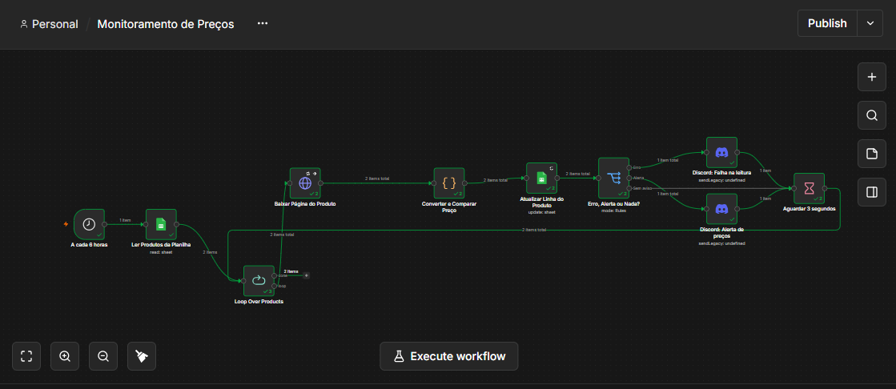

# Monitor de Preços

Fiz esse projeto para me ajudar a encontrar promoções de produtos desejados. Ele lê uma lista de produtos numa planilha do Google Sheets, abre a página de cada um, pega o preço e escreve de volta na planilha. Se o preço estiver no valor que eu quero pagar, manda uma mensagem no Discord.

**Stack:** n8n, Google Sheets, Discord (webhook) e JavaScript.

## Por que fiz isso

Queria uma automação com começo, meio e fim que eu pudesse mostrar rodando. Escolhi monitor de preço porque é fácil de explicar, e porque eu imaginava que ia dar problema com site de verdade. Deu, e boa parte do que aprendi veio daí (está no final).

## Como rodar

1. Crie uma planilha com uma aba chamada `produtos` e as colunas da tabela abaixo. Tem um exemplo em `exemplo/planilha-modelo.csv`.
2. No n8n, abra um workflow novo, clique em `⋯` > **Import from file** e escolha `workflows/monitor-precos.json`.
3. Crie as credenciais do Google Sheets e do Discord. O Discord só precisa da URL de um webhook (Editar canal > Integrações > Webhooks).
4. Nos dois nós de Google Sheets, selecione a sua planilha e a aba `produtos`. Tirei o ID da minha planilha do arquivo, então isso é obrigatório.
5. Rode na mão com um produto de teste. Se quiser ver o alerta, coloque um `preco_ideal` acima do preço real.
6. Para testar de novo, apague o `preco_promocao` da linha. Se o preço não mudou desde a última leitura, o alerta não sai (explico abaixo).
7. Funcionando, é só publicar o workflow e ele roda a cada 6 horas.

## A planilha

| Coluna               | Quem preenche | Para que serve                                           |
| -------------------- | ------------- | -------------------------------------------------------- |
| `nome`               | eu            | nome do produto                                          |
| `url`                | eu            | link da página, sem formatação nenhuma                   |
| `seletor_css`        | eu            | seletor do preço, para páginas sem JSON-LD               |
| `preco_ideal`        | eu            | quanto eu quero pagar                                    |
| `preco_promocao`     | workflow      | último preço lido                                        |
| `status`             | workflow      | `Abaixo do ideal`, `Acima do ideal` ou `Erro na leitura` |
| `ultima_verificacao` | workflow      | data e hora da última checagem                           |
| `metodo`             | eu (opcional) | se for `css`, tenta o seletor antes do JSON-LD           |

Cada URL só pode aparecer uma vez, porque é por ela que o workflow encontra a linha para atualizar.

## Como funciona

A cada 6 horas o workflow lê a planilha e passa por um produto de cada vez: baixa a página, tenta achar o preço, converte o texto em número, compara com o preço ideal, atualiza a linha e decide se avisa. Entre um produto e outro espera 3 segundos, para não bater no site em sequência.

Para achar o preço, o nó de código tenta primeiro o JSON-LD da página (explico a escolha abaixo) e, se não achar, usa o seletor CSS da planilha. Ele também converte formatos diferentes, como `R$ 1.299,90`, `1.299` ou `51.77`, porque cada site escreve de um jeito.

Existe também um segundo workflow, `workflows/cadastro-produtos.json`, com um formulário para cadastrar produtos sem mexer na planilha. Um não conhece o outro. O formulário grava uma linha nova e o monitor pega essa linha na próxima rodada.

## Decisões

**JSON-LD antes do seletor CSS.** Muita loja guarda os dados do produto num bloco `application/ld+json` dentro do HTML, e o preço fica ali. Isso muda bem menos que o layout, então tento isso primeiro. O seletor fica como plano B.

**Alerta só quando o preço muda.** Se eu avisasse sempre que o preço estivesse abaixo do ideal, receberia a mesma mensagem a cada 6 horas. Então o aviso só sai se o preço for menor ou igual ao ideal e diferente do que já estava salvo.

**Erro vira aviso.** Se uma página falha, o produto fica com `Erro na leitura`, chega uma mensagem no Discord e o workflow segue para o próximo. A outra opção era parar tudo no primeiro problema.

**Discord, não Telegram.** Comecei pelo Telegram, mas minha conta ficou bloqueada para criar bots. O webhook do Discord resolveu e é mais simples.

## Sites que testei

| Site                              | Resultado                                                             |
| --------------------------------- | --------------------------------------------------------------------- |
| books.toscrape.com                | funciona, pelo seletor CSS                                            |
| uma loja brasileira de e-commerce | funciona, pelo JSON-LD                                                |
| Amazon                            | não funciona, devolve página de bloqueio                              |
| Mercado Livre                     | não funciona, tela de tráfego suspeito (a API pública também deu 403) |
| Pichau                            | não funciona                                                          |

Nos três que falharam o workflow fez o que devia: marcou erro na planilha e avisou no Discord.

## Como testei

Não tem teste automatizado. Rodei o workflow na mão com algumas linhas na planilha e olhei o resultado de cada uma: produto abaixo do ideal (atualiza a planilha e avisa), o mesmo produto rodando de novo sem mudança (atualiza a data e não avisa), produto acima do ideal (só atualiza) e link inválido (erro na planilha e aviso de falha). O nó de código também devolve um campo `fonte_leitura` que diz se o preço veio do JSON-LD ou do CSS, o que ajudou bastante a depurar.

## O que ele não faz

Não passa por proteção anti-bot, que é o que bloqueia os sites grandes. Para isso precisaria de proxy, de uma API de scraping ou de um navegador automatizado, e não implementei nada disso. Também não lê preço que só aparece depois que o JavaScript da página roda, porque esse valor não está no HTML que o n8n recebe. E o JSON-LD às vezes traz o preço cheio, enquanto o site mostra uma promoção por cima, então vale conferir cada loja.

## O que me deu trabalho

Deixei uma linha de título acima dos cabeçalhos da planilha e o n8n passou a tratar os nomes das colunas como se fossem dados (`col_2`, `col_3`...). Tirei a linha e resolveu.

Em outro momento troquei a coluna `url` por um texto clicável ("Ver produto") e o HTTP Request começou a dar `Invalid URL`, porque o n8n lê o texto da célula e não o link que fica por trás. O erro seguinte, `No property named "data" exists`, era só consequência disso. Hoje a coluna `url` tem o link puro e existe outra coluna, só para mim, com `=HYPERLINK(...)`.

O pior de achar foi um nó de atualização da planilha que ficava verde mas não devolvia nada. Quando ele não encontra a linha, simplesmente não tem saída, e o resto do fluxo nunca roda, sem erro nenhum. Resolvi ligando o `alwaysOutputData` e fazendo o Switch ler direto do nó de código.

Com os sites grandes, o que me orientou foi olhar o que o HTTP Request realmente devolvia. No Mercado Livre, o caminho dos arquivos da página tinha `suspicious-traffic`, e ali ficou claro que não era problema do meu seletor.

Na loja que funcionou, o seletor também voltava vazio no começo. O preço aparecia no Inspecionar do navegador, mas não do jeito que estava no HTML baixado. Procurando o valor no HTML, achei o bloco JSON-LD, e foi daí que veio a leitura em duas etapas.
